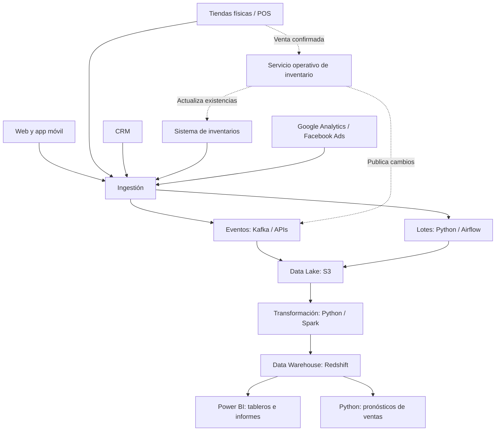

# Taller 04 — Diseño de Arquitectura de Datos para Yachay-Shop

**Maestría en Ciencia de Datos — Universidad Yachay Tech**  
**Tema:** Diseño de arquitectura de datos para una empresa de comercio electrónico.

## 1. Escenario y problema

Yachay-Shop comercializa productos a través de un sitio web, una aplicación móvil y tiendas físicas. También utiliza un CRM, un sistema de inventarios y plataformas de marketing externo. Actualmente, estos sistemas están aislados y generan datos de diferentes formatos, por lo que resulta difícil analizar las ventas, conocer integralmente al cliente y mantener una visión actualizada del inventario.

**Objetivo:** diseñar una arquitectura que integre, almacene, procese y permita analizar los datos, considerando cargas por lotes y eventos en tiempo real.

## 2. Arquitectura propuesta (HLD)

Se propone una arquitectura **híbrida: Data Lake + Data Warehouse**. El Data Lake almacena datos originales y transformados; el Data Warehouse reúne datos consolidados para inteligencia de negocios. Los eventos operativos de inventario tienen una ruta independiente para no depender de los reportes analíticos.



> El diagrama representa una propuesta conceptual, no una infraestructura ya implementada. Se incluyen herramientas de referencia que podrían sustituirse según presupuesto y necesidades.

## 3. Fuentes, ingestión y frecuencia

| Fuente | Datos principales | Método propuesto | Frecuencia |
|---|---|---|---|
| Web y app móvil | Clics, vistas, compras y perfiles | Eventos enviados mediante API y Kafka | Tiempo real para eventos |
| Tiendas físicas (POS) | Ventas y devoluciones | API o captura de cambios (CDC) a Kafka; extracción SQL alternativa | Eventos en tiempo real; conciliación diaria |
| CRM | Clientes, historial de pedidos y campañas | API o extracción SQL con Python | Por lotes, cada día |
| Inventarios | Existencias y movimientos | Eventos o CDC; sincronización mediante API | Tiempo real para cambios; conciliación periódica |
| Marketing externo | Visitas, clics, costo y conversiones | APIs oficiales y Python | Por lotes, cada día |

**Nota:** el uso de CDC o APIs depende de las capacidades reales de cada sistema. Las frecuencias son propuestas de diseño.

## 4. Almacenamiento y tratamiento de datos

- **Data Lake (Amazon S3):** datos originales en formatos como JSON y CSV; datos analíticos en Parquet. Se organiza en tres capas: *Bronze* (originales), *Silver* (validados y estandarizados) y *Gold* (listos para análisis).
- **Data Warehouse (Amazon Redshift):** tablas estructuradas para consultar ventas por fecha, canal, tienda y producto, así como datos consolidados de clientes y campañas.
- **Datos no estructurados:** si existen registros de texto u otros archivos, se conservan en el Data Lake; solo la información necesaria se transforma para análisis.

**Transformaciones necesarias:** validar campos obligatorios; eliminar duplicados; unificar fechas, monedas y nombres de productos; relacionar clientes mediante identificadores autorizados; conectar ventas con campañas cuando exista una atribución confiable; y calcular indicadores como ventas totales y unidades vendidas.

## 5. Procesamiento y disponibilidad

- **Por lotes:** Python/Airflow extrae datos periódicamente; Spark o Python transforma la información y actualiza tablas para reportes diarios, semanales y mensuales.
- **En tiempo real:** Kafka distribuye eventos de ventas e inventario. Un servicio transaccional autorizado actualiza existencias en el sistema operativo y comunica el cambio a los canales. La analítica puede consumir esos eventos sin controlar directamente la operación.
- **Inteligencia de negocios:** Power BI consulta el Data Warehouse para tableros de ventas, productos, clientes, inventario y efectividad comercial.
- **Predicción:** Python permite entrenar posteriormente modelos sencillos de pronóstico con históricos de ventas.

## 6. Seguridad, calidad y escalabilidad

- Acceso por roles y principio de mínimo privilegio.
- Cifrado de información en tránsito y en reposo.
- Protección de datos personales y gestión de autorizaciones.
- Registro de errores, auditoría y monitoreo de pipelines.
- Validación de calidad y conciliación entre sistemas.
- Almacenamiento escalable en S3 y capacidad de procesamiento ajustable a demanda; particionamiento de datos por fecha y canal.

## 7. Ejemplo sencillo en Python (demostración opcional)

El archivo [`codigo/resumen_ventas.py`](codigo/resumen_ventas.py) lee un CSV de ventas de ejemplo, valida filas y resume ventas por canal. Esto **ilustra una pequeña transformación por lotes**; no implementa Kafka, S3, Redshift ni la arquitectura completa.

**Requisitos:** Python 3; no se requieren librerías externas.

Desde la carpeta del proyecto:

```bash
python codigo/resumen_ventas.py
```

**Salida esperada:** resumen de unidades e ingresos por canal y total general.

## 8. Conclusión

La arquitectura híbrida propuesta permitiría a Yachay-Shop integrar fuentes heterogéneas, mantener información histórica, separar las operaciones de inventario de los procesos analíticos y construir reportes para la toma de decisiones. Su implementación podría realizarse por etapas, priorizando primero la integración de ventas e inventario y después los análisis de clientes y marketing.
