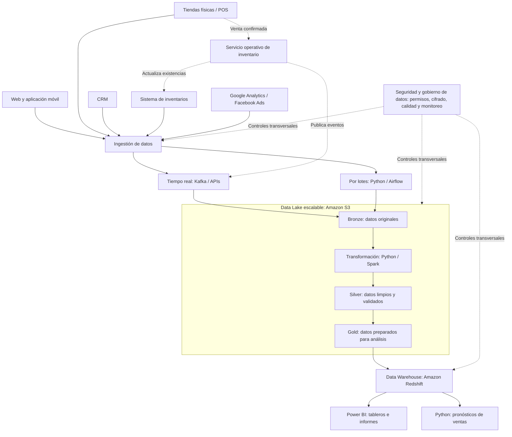

# Taller 04 — Diseño de Arquitectura de Datos para Yachay-Shop

**Maestría en Ciencia de Datos — Universidad Yachay Tech**  
**Tema:** Diseño de arquitectura de datos para una empresa de comercio electrónico.

## 1. Escenario y problema

Yachay-Shop comercializa productos a través de un sitio web, una aplicación móvil y tiendas físicas. También utiliza un CRM, un sistema de inventarios y plataformas de marketing externo. Actualmente, estos sistemas están aislados y generan datos de diferentes formatos, por lo que resulta difícil analizar las ventas, conocer integralmente al cliente y mantener una visión actualizada del inventario.

**Objetivo:** diseñar una arquitectura que integre, almacene, procese y permita analizar los datos, considerando cargas por lotes y eventos en tiempo real.

## 2. Arquitectura propuesta (HLD)

Se propone una arquitectura **híbrida: Data Lake + Data Warehouse**. El Data Lake almacena datos originales y transformados; el Data Warehouse reúne datos consolidados para inteligencia de negocios. Los eventos operativos de inventario tienen una ruta independiente para no depender de los reportes analíticos.




> El diagrama representa una propuesta conceptual, no una infraestructura ya implementada. Se incluyen herramientas de referencia que podrían sustituirse según presupuesto y necesidades.

**Lectura del HLD:** los datos llegan desde cinco sistemas, se ingieren en tiempo real o por lotes y se almacenan en S3. La organización *Bronze → Silver → Gold* representa su mejora progresiva: desde registros originales hasta datos analíticos. Después se consolidan en Redshift para consultas de Power BI y pronósticos en Python. El servicio operativo de inventario actualiza existencias sin esperar al Data Warehouse.

**Seguridad y escalabilidad:** se proponen permisos por rol, cifrado, validaciones, auditoría y monitoreo a lo largo de todo el flujo. S3 facilita ampliar el almacenamiento; los procesos y consultas pueden dimensionarse según el volumen y la frecuencia de uso. Son capacidades consideradas en el diseño, no implementadas en esta demostración.

## 3. Fuentes, ingestión y frecuencia

| Fuente | Datos principales | Método propuesto | Frecuencia |
|---|---|---|---|
| Web y app móvil | Clics, vistas, compras y perfiles | Eventos enviados mediante API y Kafka | Tiempo real para eventos |
| Tiendas físicas (POS) | Ventas y devoluciones | API o captura de cambios (CDC) a Kafka; extracción SQL alternativa | Eventos en tiempo real; conciliación diaria |
| CRM | Clientes, historial de pedidos y campañas | API o extracción SQL con Python | Por lotes, cada día |
| Inventarios | Existencias y movimientos | Eventos o CDC; sincronización mediante API | Tiempo real para cambios; conciliación periódica |
| Marketing externo | Visitas, clics, costo y conversiones | APIs oficiales y Python | Por lotes, cada día |

**Nota:** el uso de CDC o APIs depende de las capacidades reales de cada sistema. Las frecuencias son propuestas de diseño.

## 4. Almacenamiento y tratamiento de datos

- **Data Lake (Amazon S3):** datos originales en formatos como JSON y CSV; datos analíticos en Parquet. Se organiza en tres capas: *Bronze* (originales), *Silver* (validados y estandarizados) y *Gold* (listos para análisis).
- **Data Warehouse (Amazon Redshift):** tablas estructuradas para consultar ventas por fecha, canal, tienda y producto, así como datos consolidados de clientes y campañas.
- **Datos no estructurados:** si existen registros de texto u otros archivos, se conservan en el Data Lake; solo la información necesaria se transforma para análisis.

**Transformaciones necesarias:** validar campos obligatorios; eliminar duplicados; unificar fechas, monedas y nombres de productos; relacionar clientes mediante identificadores autorizados; conectar ventas con campañas cuando exista una atribución confiable; y calcular indicadores como ventas totales y unidades vendidas.

## 5. Procesamiento y disponibilidad

- **Por lotes:** Python/Airflow extrae datos periódicamente; Spark o Python transforma la información y actualiza tablas para reportes diarios, semanales y mensuales.
- **En tiempo real:** Kafka distribuye eventos de ventas e inventario. Un servicio transaccional autorizado actualiza existencias en el sistema operativo y comunica el cambio a los canales. La analítica puede consumir esos eventos sin controlar directamente la operación.
- **Inteligencia de negocios:** Power BI consulta el Data Warehouse para tableros de ventas, productos, clientes, inventario y efectividad comercial.
- **Predicción:** Python permite entrenar posteriormente modelos sencillos de pronóstico con históricos de ventas.

## 6. Seguridad, calidad y escalabilidad

- Acceso por roles y principio de mínimo privilegio.
- Cifrado de información en tránsito y en reposo.
- Protección de datos personales y gestión de autorizaciones.
- Registro de errores, auditoría y monitoreo de pipelines.
- Validación de calidad y conciliación entre sistemas.
- Almacenamiento escalable en S3 y capacidad de procesamiento ajustable a demanda; particionamiento de datos por fecha y canal.

## 7. Ejemplo práctico en Python: procesamiento de ventas por lotes

Para complementar el diseño HLD se incluye una **demostración sencilla de ETL por lotes**. Este ejemplo no implementa la infraestructura completa: solamente representa la extracción de un archivo CSV, su validación y transformación, y la carga del resumen en otro CSV.

### 7.1. Objetivo

Procesar un conjunto pequeño de ventas ficticias realizadas mediante tres canales (**Web, App y Tienda**) para obtener el total de unidades e ingresos por canal. Estos indicadores podrían alimentar posteriormente un Data Warehouse o un tablero de Power BI.

### 7.2. Archivos utilizados

- [`datos/ventas_ejemplo.csv`](datos/ventas_ejemplo.csv): datos de entrada con ID de venta, fecha, canal, producto, cantidad y precio unitario.
- [`codigo/resumen_ventas.py`](codigo/resumen_ventas.py): programa que lee, valida, transforma y resume las ventas.
- [`resultados/resumen_por_canal.csv`](resultados/resumen_por_canal.csv): archivo de salida, generado al ejecutar el programa.

### 7.3. Etapas del procesamiento

1. **Extracción:** Python lee `ventas_ejemplo.csv` mediante la librería estándar `csv`.
2. **Validación:** revisa las columnas requeridas, la fecha, los valores de cantidad y precio, campos obligatorios e identificadores repetidos. Los registros no válidos se omiten e informan.
3. **Transformación:** calcula `cantidad × precio_unitario` y agrupa unidades e ingresos por canal.
4. **Carga:** guarda el resumen procesado en `resultados/resumen_por_canal.csv`, un archivo que podría usarse como insumo analítico.

### 7.4. Ejecución

**Requisito:** Python 3 instalado; **no requiere librerías adicionales ni conexión a Internet**.

Desde la carpeta principal del repositorio, ejecutar:

```bash
python codigo/resumen_ventas.py
```

En Windows, si `python` no se reconoce, se puede probar:

```bash
py codigo/resumen_ventas.py
```

### 7.5. Resultado esperado

```text
RESUMEN DE VENTAS POR CANAL
--------------------------
App: 2 unidades | USD 71.00
Tienda: 2 unidades | USD 1070.00
Web: 2 unidades | USD 485.50
TOTAL: 6 unidades | USD 1626.50
Registros válidos: 5 | Omitidos: 0
Archivo generado: resultados/resumen_por_canal.csv
```

| Canal | Unidades vendidas | Ingresos (USD) |
|---|---:|---:|
| App | 2 | 71,00 |
| Tienda | 2 | 1.070,00 |
| Web | 2 | 485,50 |
| **Total** | **6** | **1.626,50** |

### 7.6. Relación con la arquitectura propuesta

Esta práctica representa únicamente el **procesamiento por lotes** descrito en el HLD. El archivo de entrada simula datos obtenidos desde los sistemas comerciales, Python realiza la transformación y el archivo de salida constituye un conjunto de datos preparado para análisis. En una solución de producción, las fuentes podrían conectarse mediante APIs y los resultados almacenarse en S3 o Redshift para consultarlos con Power BI.

**Alcance:** se trabaja con cinco ventas ficticias para mostrar el procedimiento. No se implementan Kafka, Spark, Amazon S3, Redshift ni actualizaciones de inventario en tiempo real; esos elementos se describen en el diseño conceptual.

## 8. Conclusión

La arquitectura híbrida propuesta permitiría a Yachay-Shop integrar fuentes heterogéneas, mantener información histórica, separar las operaciones de inventario de los procesos analíticos y construir reportes para la toma de decisiones. Su implementación podría realizarse por etapas, priorizando primero la integración de ventas e inventario y después los análisis de clientes y marketing.
